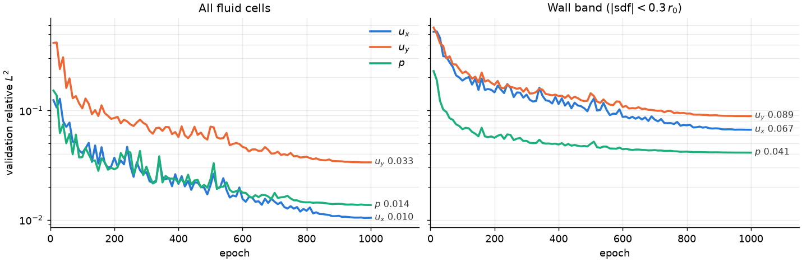
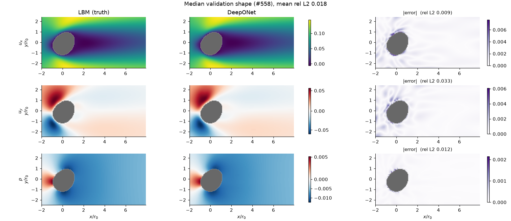
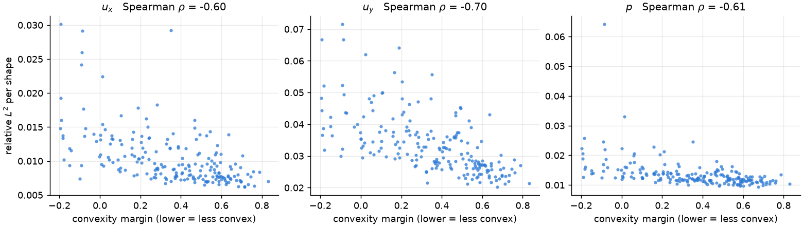
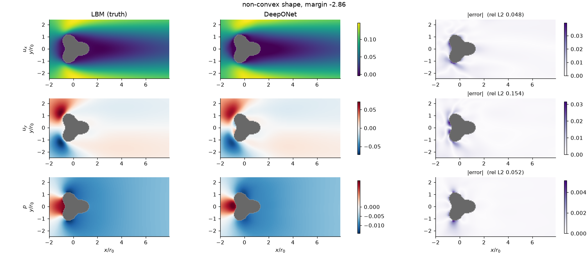

# Operator Learning

**Status:** In progress. A DeepONet trained on 1200 convex shapes reaches 1–3% relative error in distribution. Out-of-distribution evaluation has started with a first non-convex shape. Sharp corners and multiple obstacles are still to do.

---

## Problem statement

Neural operator surrogates predict a simulation's output in milliseconds rather than minutes, which makes them useful in engineering design, where many shapes need to be evaluated quickly. But in design they are used on new shapes, unlike anything in their training data. There a surrogate can be wrong while its predictions still look physically plausible. To know when to trust it, we need to know which kinds of new geometry it handles, and why it fails on the rest.

This project asks:

> **When a DeepONet trained on flow around smooth convex obstacles meets unseen shapes, where and why does it fail?**

**Approach.** A lattice Boltzmann solver, written from scratch and validated against flow past a cylinder, generates steady 2D flow at Re = 20 around random smooth convex obstacles. A DeepONet learns to map each obstacle's signed distance field to the velocity and pressure fields. It is then tested on shapes that move step by step away from the training data along three axes: more concavity, sharp corners, and multiple obstacles.

---

## Background: operator learning

Standard supervised learning methods map vectors to vectors (a feature vector to a target vector), in other words the method learns a function. Operator learning maps *functions* to *functions*; here, an input function $u$ to the output of some operator applied to it.

---

## Problem Setup

### Antiderivative operator (validation case)

$$
G: u \mapsto s, \qquad s(x) = \int_0^x u(t) \, dt, \qquad s(0) = 0
$$

This case is deliberately trivial as an application and quadrature solves it to machine precision. It is used to debug the implementation rather than as a difficult learning problem.

### Steady flow past a convex body

$$
G: \text{shape} \mapsto (u_x, u_y, p)
$$

The operator maps the geometry of a 2D body in a channel to the steady flow field around it at $Re = 20$. The shape is given to the network as its signed distance function (SDF), and the output is the velocity and pressure at arbitrary query points.

---

## Data Generation

### Gaussian random functions

Input functions are drawn from a Gaussian process on $[0, 1]$ with an RBF kernel

$$
k(x, x') = \exp\left(-\frac{(x - x')^2}{2\ell^2}\right)
$$

This uses a Cholesky factorisation to transform a random sample $z$ into $u \sim N(0, K)$.

For the antiderivative, each $u$ is sampled on a fine grid and integrated using the cumulative trapezium rule.

### Convex shapes

Body boundaries are defined in polar form around the centre $(c_x, c_y)$:

$$
r(\theta) = r_0 \left(1 + a_1 \cos(\theta - \phi_1) + a_2 \cos 2(\theta - \phi_2) + \varepsilon\, g(\theta)\right)
$$

Here $g$ is a periodic Gaussian random function and $a_1, a_2, \phi_1, \phi_2$ are drawn uniformly. Shapes are kept only if they are (close to) convex. The check uses the curvature of the boundary, which is computed spectrally from $r$, $r'$ and $r''$.

### Flow solver

Each shape is solved with a D2Q9 lattice Boltzmann solver ([src/solvers/lbm.py](src/solvers/lbm.py)), written in JAX and batched across shapes. The body uses bounce-back walls. The solver runs until the field stops changing (tolerance $10^{-5}$), and shapes that don't converge are dropped.

Generate the dataset with:

```bash
uv run python scripts/generate_dataset.py
```

This writes `data/train_convex.npz` (masks, SDFs, $u_x$, $u_y$, $p$, radii, convexity margins) and `data/train_convex.json` (grid size, $r_0$, centre, $Re$ and the shape-sampling settings). The default grid is $150 \times 600$ with $r_0 = 15$.

---

## Model and Training

[src/model.py](src/model.py) implements a DeepONet with three outputs:

- **Branch net:** an MLP on the SDF, downsampled to $32 \times 64$ and flattened.
- **Trunk net:** an MLP on the query coordinates $(x, y)$, in units of $r_0$ relative to the body centre.

The output for each field is the dot product of the branch and trunk features, plus a bias.

[src/train.py](src/train.py) works as follows:

- Crops the domain to $[-2r_0, 8r_0] \times [-2.5r_0, 2.5r_0]$ around the body.
- Measures pressure relative to the upstream edge.
- Normalises each field with mean and std from the training fluid cells.
- Holds out 200 shapes for validation.
- Trains with AdamW (peak LR $5 \times 10^{-4}$, gradients clipped to norm 1), linear warmup and cosine decay. Each batch uses 32 shapes and 2048 random query points, and the MSE is masked to fluid cells.
- Optionally oversamples query points near the body: `WALL_FRAC` of each batch's points come from cells within `WALL_BAND` of a training body's surface.
- Every 10 epochs, reports the relative $L^2$ error on the validation set for each field, over all fluid cells and over the wall band ($|\text{sdf}| < 0.3\,r_0$).

```bash
EPOCHS=1000 WALL_FRAC=0.5 uv run python src/train.py
```

The best model is saved to `checkpoints/best.pt`, together with its model config, normalisation stats, data config and train/val split. The loss history goes to `checkpoints/history.json`. To reload the model:

```python
ckpt = torch.load("checkpoints/best.pt")
model = DeepONet(**ckpt["model_cfg"])
model.load_state_dict(ckpt["model"])
```

---

## Results

Trained for 1000 epochs with `WALL_FRAC=0.5`, evaluated on 200 held-out shapes:

| Validation relative $L^2$ | $u_x$ | $u_y$ | $p$ |
|---|---|---|---|
| All fluid cells | 0.010 | 0.033 | 0.014 |
| Wall band ($\|\text{sdf}\| < 0.3\,r_0$) | 0.067 | 0.089 | 0.041 |

$u_y$ has the highest relative error mostly because it is close to zero over most of the domain. The wall band is harsher still, because no-slip drives the velocity towards zero there.



The predicted fields for a typical validation shape (median error) match the LBM closely. What error remains is concentrated in a thin layer at the body surface:



Error grows steadily as shapes become less convex, even within the training distribution:



On a non-convex trefoil (convexity margin −2.86, far below the training minimum of −0.2), the model still gets the overall flow right: the wake, the acceleration around the body, and the stagnation pressure. But it smooths over the concave notches, and the error is about 4–5× the validation median (`ux` 0.048, `uy` 0.154, `p` 0.052):



---

## Layout

```text
scripts/generate_dataset.py   shape sampling + LBM solves -> data/
src/grf.py                    Gaussian random function sampling
src/geometry.py               shape sampling, masks, SDF, convexity test
src/solvers/lbm.py            batched JAX lattice Boltzmann solver
src/model.py                  DeepONet
src/train.py                  training on the convex-shape dataset
src/data_generator.py         antiderivative targets
```
